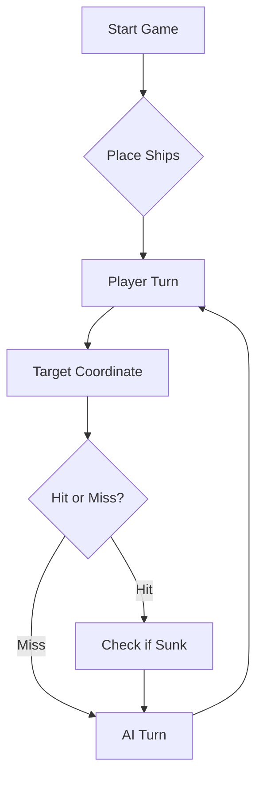

# ⚓ Battleship 2.0


> A modern take on the classic naval warfare game, designed for the XVII century setting with updated software engineering patterns.

---

## 📖 Table of Contents
- [Project Overview](#-project-overview)
- [Key Features](#-key-features)
- [Technical Stack](#-technical-stack)
- [Installation & Setup](#-installation--setup)
- [Code Architecture](#-code-architecture)
- [Roadmap](#-roadmap)
- [Contributing](#-contributing)

---

## 🎯 Project Overview
This project serves as a template and reference for students learning **Object-Oriented Programming (OOP)** and **Software Quality**. It simulates a battleship environment where players must strategically place ships and sink the enemy fleet.

### 🎮 The Rules
The game is played on a grid (typically 10x10). The coordinate system is defined as:

$$(x, y) \in \{0, \dots, 9\} \times \{0, \dots, 9\}$$

Hits are calculated based on the intersection of the shot vector and the ship's bounding box.

---

## ✨ Key Features
| Feature | Description | Status |
| :--- | :--- | :---: |
| **Grid System** | Flexible $N \times N$ board generation. | ✅ |
| **Ship Varieties** | Galleons, Frigates, and Brigantines (XVII Century theme). | ✅ |
| **AI Opponent** | Heuristic-based targeting system. | 🚧 |
| **Network Play** | Socket-based multiplayer. | ❌ |

---

## 🛠 Technical Stack
* **Language:** Java 17
* **Build Tool:** Maven / Gradle
* **Testing:** JUnit 5
* **Logging:** Log4j2

---

## 🚀 Installation & Setup

### Prerequisites
* JDK 17 or higher
* Git

### Step-by-Step
1. **Clone the repository:**
   ```bash
   git clone [https://github.com/britoeabreu/Battleship2.git](https://github.com/britoeabreu/Battleship2.git)
   ```
2. **Navigate to directory:**
   ```bash
   cd Battleship2
   ```
3. **Compile and Run:**
   ```bash
   javac Main.java && java Main
   ```

---

## 📚 Documentation

You can access the generated Javadoc here:

👉 [Battleship2 API Documentation](https://britoeabreu.github.io/Battleship2/)


### Core Logic
```java
public class Ship {
    private String name;
    private int size;
    private boolean isSunk;

    // TODO: Implement damage logic
    public void hit() {
        // Implementation here
    }
}
```

### Design Patterns Used:
- **Strategy Pattern:** For different AI difficulty levels.
- **Observer Pattern:** To update the UI when a ship is hit.
</details>

### Logic Flow


---

## 🗺 Roadmap
- [x] Basic grid implementation
- [x] Ship placement validation
- [ ] Add sound effects (SFX)
- [ ] Implement "Fog of War" mechanic
- [ ] **Multiplayer Integration** (High Priority)

---

## 🧪 Testing
We use high-coverage unit testing to ensure game stability. Run tests using:
```bash
mvn test
```

> [!TIP]
> Use the `-Dtest=ClassName` flag to run specific test suites during development.

---

## 🤝 Contributing
Contributions are what make the open-source community such an amazing place to learn, inspire, and create.

1. Fork the Project
2. Create your Feature Branch (`git checkout -b feature/AmazingFeature`)
3. Commit your Changes (`git commit -m 'Add some AmazingFeature'`)
4. Push to the Branch (`git push origin feature/AmazingFeature`)
5. Open a **Pull Request**

---
## Link do Youtube
https://youtu.be/bzHZHKtsys8

---
## Estratégia de Jogo da Inteligência Artificial (LLM)

Age como um comandante tático de elite no jogo da Batalha Naval. O teu objetivo é afundar toda a frota inimiga com o menor número de tiros possível, utilizando raciocínio lógico rigoroso passo a passo (Chain-of-Thought).


### Regras do Jogo e Frota

O tabuleiro tem dimensões de 10x10 (linhas A a J, colunas 1 a 10).
Cada rajada tua consiste em exatamente 3 tiros.
Regra de Adjacência: Os navios NUNCA se tocam, nem na horizontal, nem na vertical, nem nas diagonais.
Frota Inimiga:
  - 4 Barcas (1 posição)

  - 3 Caravelas (2 posições alinhadas)

  - 2 Naus (3 posições alinhadas)

  - 1 Fragata (4 posições alinhadas)

  - 1 Galeão (Formato em "T": 1 haste de 3 posições e 2 asas perpendiculares numa das pontas)


---


### Diretrizes Táticas de Disparo


**Gestão do Diário de Bordo e Memória:**
   - Mantém um registo sequencial de todas as rajadas (Rajada 1, 2, 3...).

   - Regista cada coordenada disparada e o respetivo feedback (Água, Navio Atingido, Navio Afundado).

   - NUNCA repitas coordenadas já disparadas e NUNCA dispares fora dos limites do mapa (A1 a J10). A única exceção de repetição permitida é na última rajada, caso já tenhas afundado tudo e precises de perfazer os 3 tiros obrigatórios.


2. **Dedução de Impactos e Halo de Água:**

   - Navios lineares (Caravela, Nau, Fragata): Um impacto certeiro significa que o restante navio está na horizontal ou na vertical. Como os navios não se tocam, as diagonais a um impacto certeiro são garantidamente ÁGUA (exceto nas junções internas do Galeão). Poupa tiros evitando essas diagonais.

   - Quando um navio for confirmado como "Afundado", identifica no teu histórico todas as coordenadas que o compunham e marca todo o halo de 1 casa ao seu redor (incluindo diagonais) como ÁGUA INTRANSITÁVEL. Não dispares aí.


3. **Geometria do Galeão (Forma em "T"):**

   - Ao atingir um Galeão, deduz e testa as 4 orientações possíveis do T (haste de 3 com asas na ponta). Tem em atenção que as asas formam diagonais internas válidas apenas para o próprio Galeão.


4. **Modo Caça (Varrimento por Paridade):**

   - Quando não houver navios feridos para abater, não dispares em células contíguas. Utiliza um padrão alternado em xadrez com espaçamento mínimo de 2 posições.

   - Filtro de Comprimento Mínimo: Se todas as Barcas (1x1) já estiverem no fundo, nunca dispares num espaço isolado de 1 casa livre. Se o menor navio restante tiver tamanho N, qualquer espaço livre contínuo menor que N é considerado água garantida.


5. **Foco e Múltiplos Impactos:**

   - Se uma rajada acertar em múltiplos barcos, prioriza abater um de cada vez até receber a confirmação de afundamento antes de dispersar a atenção.


---


### Estrutura Obrigatória da Tua Resposta a Cada Turno


Apresenta impreterivelmente o raciocínio antes da decisão, terminando no bloco JSON:


### 1. Diário de Bordo Atualizado

Lista de tiros anteriores e respetivos resultados.
Mapeamento mental de células bloqueadas (água confirmada e halos de navios afundados).


### 2. Estado da Frota Inimiga

Navios Afundados vs. Navios Ainda a Flutuar.


### 3. Justificação Tática da Próxima Rajada

Justificação analítica para cada uma das 3 coordenadas escolhidas.


```json

{

  rajada COORD1 COORD2 COORD3

} 
---

## 📄 License
Distributed under the MIT License. See `LICENSE` for more information.

---
**Maintained by:** [@britoeabreu](https://github.com/britoeabreu)  
*Created for the Software Engineering students at ISCTE-IUL.*
