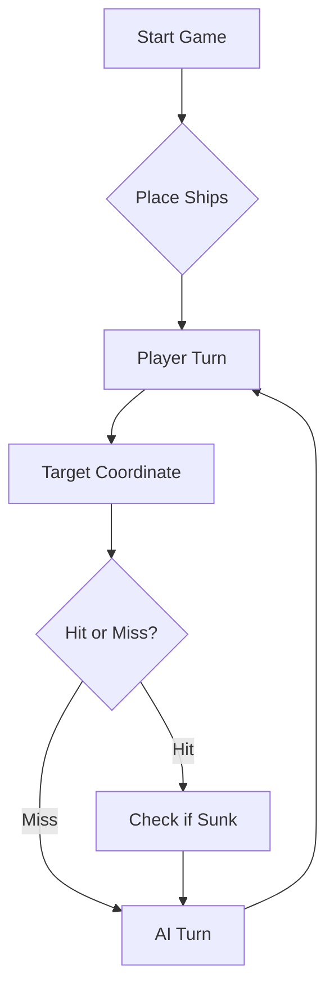

# ⚓ Battleship 2.0


> A modern take on the classic naval warfare game, designed for the XVII century setting with updated software engineering patterns.

---

## 📖 Table of Contents
- [Project Overview](#-project-overview)
- [Key Features](#-key-features)
- [Technical Stack](#-technical-stack)
- [Installation & Setup](#-installation--setup)
- [Code Architecture](#-code-architecture)
- [Roadmap](#-roadmap)
- [Contributing](#-contributing)

---

## 🎯 Project Overview
This project serves as a template and reference for students learning **Object-Oriented Programming (OOP)** and **Software Quality**. It simulates a battleship environment where players must strategically place ships and sink the enemy fleet.

### 🎮 The Rules
The game is played on a grid (typically 10x10). The coordinate system is defined as:

$$(x, y) \in \{0, \dots, 9\} \times \{0, \dots, 9\}$$

Hits are calculated based on the intersection of the shot vector and the ship's bounding box.

---

## ✨ Key Features
| Feature | Description | Status |
| :--- | :--- | :---: |
| **Grid System** | Flexible $N \times N$ board generation. | ✅ |
| **Ship Varieties** | Galleons, Frigates, and Brigantines (XVII Century theme). | ✅ |
| **AI Opponent** | Heuristic-based targeting system. | 🚧 |
| **Network Play** | Socket-based multiplayer. | ❌ |

---

## 🛠 Technical Stack
* **Language:** Java 17
* **Build Tool:** Maven / Gradle
* **Testing:** JUnit 5
* **Logging:** Log4j2

---

## 🚀 Installation & Setup

### Prerequisites
* JDK 17 or higher
* Git

### Step-by-Step
1. **Clone the repository:**
   ```bash
   git clone [https://github.com/britoeabreu/Battleship2.git](https://github.com/britoeabreu/Battleship2.git)
   ```
2. **Navigate to directory:**
   ```bash
   cd Battleship2
   ```
3. **Compile and Run:**
   ```bash
   javac Main.java && java Main
   ```

---

## 📚 Documentation

You can access the generated Javadoc here:

👉 [Battleship2 API Documentation](https://britoeabreu.github.io/Battleship2/)


### Core Logic
```java
public class Ship {
    private String name;
    private int size;
    private boolean isSunk;

    // TODO: Implement damage logic
    public void hit() {
        // Implementation here
    }
}
```

### Design Patterns Used:
- **Strategy Pattern:** For different AI difficulty levels.
- **Observer Pattern:** To update the UI when a ship is hit.
</details>

### Logic Flow


---

## 🗺 Roadmap
- [x] Basic grid implementation
- [x] Ship placement validation
- [ ] Add sound effects (SFX)
- [ ] Implement "Fog of War" mechanic
- [ ] **Multiplayer Integration** (High Priority)

---

## 🧪 Testing
We use high-coverage unit testing to ensure game stability. Run tests using:
```bash
mvn test
```

> [!TIP]
> Use the `-Dtest=ClassName` flag to run specific test suites during development.

---

## 🤝 Contributing
Contributions are what make the open-source community such an amazing place to learn, inspire, and create.

1. Fork the Project
2. Create your Feature Branch (`git checkout -b feature/AmazingFeature`)
3. Commit your Changes (`git commit -m 'Add some AmazingFeature'`)
4. Push to the Branch (`git push origin feature/AmazingFeature`)
5. Open a **Pull Request**

---
## Estratégia de Jogo da Inteligência Artificial (LLM)

Para a realização da **Parte D**, desenvolveu-se e refinou-se um prompt estratégico de modo a orientar o modelo de linguagem (LLM) a atuar como um adversário tático eficiente, evitando disparos aleatórios, respeitando as restrições espaciais e otimizando a destruição da frota inimiga através de raciocínio passo a passo (*Chain-of-Thought*).

### Prompt Final da Estratégia (utilizado no LLM)
Considere agora a seguinte tática de geração de rajadas de tiros.

• Crie um Diário de Bordo com o registo de cada rajada disparada, numerando-as se
quencialmente (Rajada 1, 2, 3...). Guarde as coordenadas exatas de cada tiro e o
respetivo resultado (Água, Nau atingida, Barca afundada, etc.). A memória é a prin
cipal arma de um bom estratega.

• Não dispare fora dos limites do mapa (ex: Z99) nem repita tiros em coordenadas
já testadas. A única exceção para este desperdício de pólvora é a última rajada do
jogo, apenas para perfazer os 3 tiros obrigatórios quando a frota inimiga já estiver
irremediavelmente no fundo do mar.

• Se atingir um navio numa rajada, dispare nas posições contíguas (Norte, Sul, Este,
Oeste) na jogada seguinte para descobrir a orientação da embarcação e acabar de a
afundar. No entanto, se a rajada anterior confirmar que o navio já foi afundado, não
dispare para as posições contíguas, pois os navios nunca estão encostados.

• Como as Caravelas, Naus e Fragatas são linhas retas, um tiro certeiro significa que o
resto do navio está na horizontal ou na vertical. Como os navios não se podem tocar
(nem sequer nos cantos), as posições diagonais a um tiro certeiro são garantidamente
água (a única exceção é o corpo do Galeão, devido à sua forma em T). Evitar estas
diagonais poupa imensos tiros.

• Quandoorelatório de uma rajada confirmar que um navio foi afundado (ex: Fragata de
4 posições), analise os dados do seu Diário de Bordo para identificar exatamente onde
caíram esses 4 tiros. Confirmada a posição exata da carcaça, marque todas as qua
drículas adjacentes (o halo de 1 posição em redor do navio) como água intransitável.
É impossível haver outra embarcação nesse perímetro.

• Se a sua frota for toda afundada, declare a derrota com honra. Em contrapartida, seja
um vencedor magnânimo se for o inimigo a render-se com os navios todos no fundo
do oceano!
• Dedução e Restrição Geométrica do Galeão (Forma em "T"):
O Galeão é a única embarcação com formato não-linear: possui uma haste de 3 posições e 2 asas perpendiculares numa das extremidades.
Ao identificar um Galeão, teste sistematicamente a orientação do T (Norte, Sul, Este ou Oeste), tendo em conta que as suas asas criam adjacências diagonais internas válidas apenas para o próprio barco.

• Regra de Paridade e Espaçamento de Varrimento (Modo Caça):
Em modo de busca/varrimento (quando não há alvos ativos para abater), nunca dispare em quadrículas contíguas. 
Utilize um padrão alternado tipo "tabuleiro de xadrez" com espaçamento mínimo de 2 posições entre tiros, uma vez que a menor embarcação oculta com mais de 1 casa (a Caravela) ocupa 2 posições contíguas.

• Proibição de Posições Impossíveis (Filtro de Tamanho Máximo):
Não dispare em espaços isolados de 1 quadrícula livre se todas as 4 Barcas já tiverem sido afundadas.
Se a menor embarcação restante por afundar tiver tamanho N (ex.: restam apenas Naus de tamanho 3 e Fragata de tamanho 4), qualquer intervalo contínuo de casas livres menor que N é considerado água garantida e não deve receber tiros.

• Tratamento de Respostas com Múltiplos Barcos Atingidos:
Se uma rajada devolver impactos em barcos diferentes (ou múltiplos barcos do mesmo tipo), isole cada coordenada suspeita e ataque uma de cada vez nas jogadas seguintes até obter a confirmação de afundamento ("sunkBoats") de uma delas antes de dispersar tiros.

• Estrutura Obrigatória de Saída a Cada Jogada:
Antes de gerar o bloco JSON da jogada, apresente sempre:
    1. Atualização do Diário de Bordo com o estado de cada coordenada já testada.
    2. Lista de navios inimigos ainda a flutuar vs. afundados.
    3. Justificação tática de cada uma das 3 coordenadas escolhidas para a próxima rajada.
---

## 📄 License
Distributed under the MIT License. See `LICENSE` for more information.

---
**Maintained by:** [@britoeabreu](https://github.com/britoeabreu)  
*Created for the Software Engineering students at ISCTE-IUL.*
